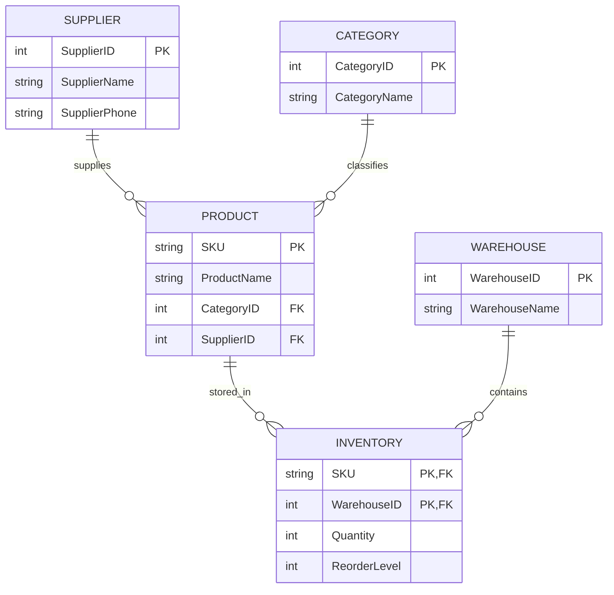

# Task 01 – Retail Inventory Normalisation to 3NF

## 1. Problem Statement

A retailer currently maintains product inventory information in a single spreadsheet.

The spreadsheet contains the following attributes:

- SKU
- Product Name
- Category
- Supplier Name
- Supplier Phone
- Warehouse
- Quantity
- Reorder Level

Customer reviews are stored separately as free text.

Maintaining all inventory information in one spreadsheet can cause data duplication, inconsistency and difficulties when inserting, updating or deleting records.

The objective is to normalise the inventory database up to Third Normal Form (3NF).

## 2. Original Unnormalised Table

The original spreadsheet can be represented as:

**RetailInventory**

| SKU | ProductName | Category | SupplierName | SupplierPhone | Warehouse | Quantity | ReorderLevel |
|---|---|---|---|---|---|---:|---:|
| P101 | Laptop | Electronics | ABC Suppliers | 9876543210 | Chennai | 20 | 5 |
| P102 | Mouse | Accessories | XYZ Traders | 9876501234 | Chennai | 50 | 10 |
| P103 | Keyboard | Accessories | XYZ Traders | 9876501234 | Bangalore | 30 | 8 |
| P101 | Laptop | Electronics | ABC Suppliers | 9876543210 | Bangalore | 15 | 5 |

The table contains repeated supplier, product and warehouse information.

*Note: The records above are illustrative sample data.*

## 3. Anomalies in the Original Table

### A. Insertion Anomaly

An insertion anomaly occurs when a new piece of information cannot be inserted without adding unrelated information.

Example:

- A new supplier is registered, but the supplier has not supplied any products yet.
- The supplier cannot be recorded easily because the spreadsheet expects product and inventory information.

### B. Update Anomaly

An update anomaly occurs when the same information is stored in multiple rows and must be updated everywhere.

Example:

- If ABC Suppliers changes its phone number, every row containing that supplier must be updated.
- If one row is missed, the spreadsheet will contain inconsistent phone numbers.

### C. Deletion Anomaly

A deletion anomaly occurs when deleting one record unintentionally removes other important information.

Example:

- If the only product supplied by a particular supplier is deleted, the supplier's contact information may also be lost.

## 4. Functional Dependencies

Functional dependencies describe how one attribute determines another attribute.

Based on the business scenario, the following dependencies are assumed:

1. SKU → ProductName, Category, SupplierID
2. SupplierID → SupplierName, SupplierPhone
3. CategoryID → CategoryName
4. WarehouseID → WarehouseName
5. (SKU, WarehouseID) → Quantity, ReorderLevel

The composite key (SKU, WarehouseID) uniquely identifies an inventory record for a product in a particular warehouse.

## 5. Normalisation Process

### First Normal Form (1NF)

A table is in 1NF when:

- Each column contains atomic values.
- Each cell contains only one value.
- There are no repeating groups.
- Each row can be uniquely identified.

In the original spreadsheet, product and supplier details are repeated across multiple inventory records.

To achieve 1NF:

- Store one product and warehouse combination per row.
- Keep each attribute atomic.
- Identify each inventory record using SKU and Warehouse.

The resulting table has a composite primary key:

**(SKU, WarehouseID)**

### Second Normal Form (2NF)

A table is in 2NF when:

- It is already in 1NF.
- Every non-key attribute depends on the entire candidate key.
- There are no partial dependencies.

In the inventory table, the composite key is (SKU, WarehouseID).

However:

- ProductName depends only on SKU.
- Category depends only on SKU.
- Supplier information depends on the product's supplier.
- WarehouseName depends only on WarehouseID.
- Quantity and ReorderLevel depend on both SKU and WarehouseID.

These are partial dependencies.

To remove them, the table is divided into separate entities:

1. Product
2. Supplier
3. Category
4. Warehouse
5. Inventory

### Third Normal Form (3NF)

A table is in 3NF when:

- It is already in 2NF.
- It contains no transitive dependencies.
- Every non-key attribute depends directly on the key.

SupplierName and SupplierPhone depend on SupplierID, not directly on SKU.

Similarly, CategoryName depends on CategoryID, and WarehouseName depends on WarehouseID.

Therefore, supplier, category and warehouse details are stored in separate tables.

This removes transitive dependencies and achieves 3NF.

## 6. Final Normalised Database Tables

The final database contains five tables.

### Table 1: Supplier

| Column | Description |
|---|---|
| SupplierID | Primary Key |
| SupplierName | Name of supplier |
| SupplierPhone | Supplier contact number |

### Table 2: Category

| Column | Description |
|---|---|
| CategoryID | Primary Key |
| CategoryName | Product category |

### Table 3: Product

| Column | Description |
|---|---|
| SKU | Primary Key |
| ProductName | Product name |
| CategoryID | Foreign Key |
| SupplierID | Foreign Key |

### Table 4: Warehouse

| Column | Description |
|---|---|
| WarehouseID | Primary Key |
| WarehouseName | Warehouse location/name |

### Table 5: Inventory

| Column | Description |
|---|---|
| SKU | Foreign Key |
| WarehouseID | Foreign Key |
| Quantity | Available stock quantity |
| ReorderLevel | Minimum stock level before reordering |

**Primary Key:** (SKU, WarehouseID)

## 7. Relationships Between Tables

The following relationships are established:

1. One supplier can supply many products.
2. One category can contain many products.
3. One product can be stored in multiple warehouses.
4. One warehouse can store multiple products.
5. The Inventory table connects products and warehouses.

## 8. ER Diagram

## 9. Assumptions

1. Each product has one primary supplier.
2. Each product belongs to one category.
3. A product can be stored in multiple warehouses.
4. Each product and warehouse combination has one inventory record.
5. ReorderLevel is maintained separately for each product at each warehouse.
6. Supplier, category and warehouse names are uniquely identified using their respective IDs.

## 10. Advantages of 3NF

- Reduces duplicate data.
- Prevents insertion, update and deletion anomalies.
- Improves data consistency.
- Makes database maintenance easier.
- Establishes clear relationships using primary and foreign keys.
- Supports better data integrity.

## 11. Conclusion

The original retail inventory spreadsheet contained repeated information about products, suppliers and warehouses.

By applying 1NF, 2NF and 3NF, the original table was decomposed into five related tables: Supplier, Category, Product, Warehouse and Inventory.

The final database structure reduces redundancy, eliminates the identified anomalies and provides a well-organised foundation for implementing the retail inventory system using SQL Server.