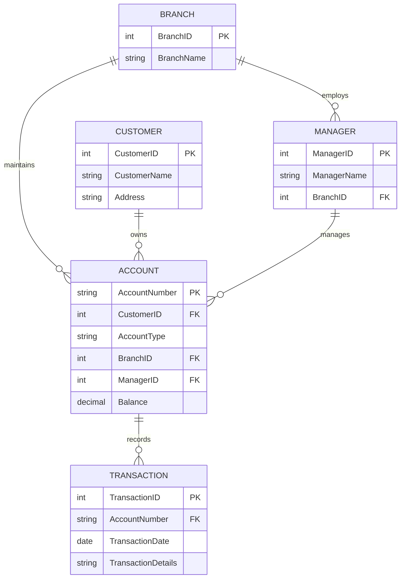

# Task 1 – Bank Branch Accounts and Customer Activity

## 1. Business Scenario

A bank branch maintains customer and account information in a single spreadsheet containing customer name, address, account number, account type, branch, relationship manager, balance and last transaction details.

Storing all this information in one table can cause data redundancy and insertion, update and deletion anomalies.

The objective is to normalise the data into Third Normal Form (3NF) and Boyce-Codd Normal Form (BCNF).

## 2. Functional Dependencies

The following functional dependencies are identified:

- CustomerID → CustomerName, Address
- AccountNumber → CustomerID, AccountType, BranchID, Balance
- BranchID → BranchName
- ManagerID → ManagerName
- AccountNumber → ManagerID
- TransactionID → AccountNumber, TransactionDetails, TransactionDate

## 3. Problems in the Original Table

**Insertion Anomaly:** A new branch cannot be stored unless an account is created for that branch.

**Update Anomaly:** If a branch name changes, it must be updated in multiple account records.

**Deletion Anomaly:** Deleting the only account belonging to a customer may also remove the customer's information.

## 4. Normalisation Process

### First Normal Form (1NF)

- Each column contains atomic values.
- Each record represents one account.
- Repeating groups are eliminated.
- AccountNumber is used as the primary key for the account records.

### Second Normal Form (2NF)

- The table is in 1NF.
- Customer details, branch details and manager details are separated from account information.
- Partial dependencies are eliminated.

### Third Normal Form (3NF)

- The table is in 2NF.
- Transitive dependencies are removed.
- Branch information, customer information and manager information are stored independently.

### Boyce-Codd Normal Form (BCNF)

- Every determinant in the resulting relations is a candidate key.
- Each relation satisfies the BCNF condition under the functional dependencies and assumptions defined below.

## 5. Final Normalised Tables

### Customer

| Column | Description |
|---|---|
| CustomerID (PK) | Unique customer identifier |
| CustomerName | Customer name |
| Address | Customer address |

### Branch

| Column | Description |
|---|---|
| BranchID (PK) | Unique branch identifier |
| BranchName | Branch name |

### Manager

| Column | Description |
|---|---|
| ManagerID (PK) | Unique manager identifier |
| ManagerName | Relationship manager name |
| BranchID (FK) | Associated branch |

### Account

| Column | Description |
|---|---|
| AccountNumber (PK) | Unique account number |
| CustomerID (FK) | Account owner |
| AccountType | Savings or current account |
| BranchID (FK) | Associated branch |
| ManagerID (FK) | Assigned relationship manager |
| Balance | Current account balance |

### Transaction

| Column | Description |
|---|---|
| TransactionID (PK) | Unique transaction identifier |
| AccountNumber (FK) | Associated account |
| TransactionDate | Transaction date |
| TransactionDetails | Transaction description |

## 6. Candidate Keys and Composite Keys

**Candidate Keys:**
- Customer: CustomerID
- Branch: BranchID
- Manager: ManagerID
- Account: AccountNumber
- Transaction: TransactionID

**Composite Key:**

The Transaction table can alternatively use the composite key (AccountNumber, TransactionDate, TransactionSequence) if a separate TransactionID is not used.

For this design, TransactionID is the selected primary key.

## 7. ER Diagram

## 8. Assumptions

1. Each customer can own multiple bank accounts, but each account belongs to one customer.
2. Each account is maintained by one branch and assigned to one relationship manager.
3. A branch can have multiple relationship managers, and each transaction belongs to one account.

## 9. Conclusion

The original spreadsheet was decomposed into five related tables: Customer, Branch, Manager, Account and Transaction.

Normalisation reduces data duplication, prevents insertion, update and deletion anomalies, and improves data consistency. The resulting design satisfies 3NF and BCNF under the stated assumptions.
