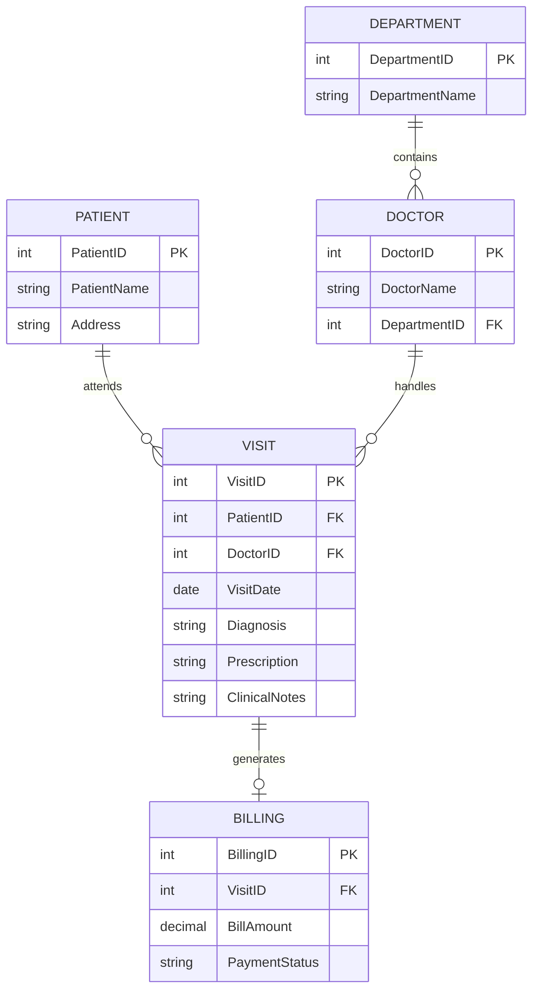

# Task 1 – Hospital Patient Records Normalisation

## 1. Business Scenario

A hospital stores patient visit information in one wide spreadsheet containing patient name, address, doctor, department, visit date, diagnosis, prescription, bill amount and clinical notes.

Storing all this information in a single table causes data redundancy and insertion, update and deletion anomalies.

The objective is to normalise the data into Third Normal Form (3NF).

## 2. Functional Dependencies

The following functional dependencies are considered:

- PatientID → PatientName, Address
- DoctorID → DoctorName, DepartmentID
- DepartmentID → DepartmentName
- VisitID → PatientID, DoctorID, VisitDate, Diagnosis, Prescription, ClinicalNotes
- BillingID → VisitID, BillAmount, PaymentStatus

## 3. Anomalies in the Original Table

**Insertion Anomaly:** A new doctor cannot be recorded unless a patient visit is also created.

**Update Anomaly:** If a department name changes, it must be updated in multiple patient visit records.

**Deletion Anomaly:** Deleting a patient's only visit may accidentally remove information about the doctor or department.

## 4. Normalisation Process

### First Normal Form (1NF)

- Each column contains atomic values.
- Repeating groups are eliminated.
- Each row represents an individual visit.
- A unique VisitID identifies each visit.

### Second Normal Form (2NF)

- The table is in 1NF.
- Patient details, doctor details and department details are separated.
- Partial dependencies are eliminated.

### Third Normal Form (3NF)

- The table is in 2NF.
- Transitive dependencies are eliminated.
- Department information is stored separately from doctor information.
- Billing information is separated from visit details.

## 5. Final Normalised Tables

### Patient

| Column | Description |
|---|---|
| PatientID (PK) | Unique patient identifier |
| PatientName | Patient name |
| Address | Patient address |

### Department

| Column | Description |
|---|---|
| DepartmentID (PK) | Unique department identifier |
| DepartmentName | Department name |

### Doctor

| Column | Description |
|---|---|
| DoctorID (PK) | Unique doctor identifier |
| DoctorName | Doctor name |
| DepartmentID (FK) | Associated department |

### Visit

| Column | Description |
|---|---|
| VisitID (PK) | Unique visit identifier |
| PatientID (FK) | Patient attending |
| DoctorID (FK) | Doctor attending |
| VisitDate | Date of visit |
| Diagnosis | Patient diagnosis |
| Prescription | Prescribed medication |
| ClinicalNotes | Clinical observations |

### Billing

| Column | Description |
|---|---|
| BillingID (PK) | Unique billing identifier |
| VisitID (FK) | Associated visit |
| BillAmount | Total bill amount |
| PaymentStatus | Payment status |

## 6. Relationships

- One patient can have multiple visits.
- One doctor can attend multiple visits.
- One department can have multiple doctors.
- One visit can have one billing record.

## 7. ER Diagram

## 8. Assumptions

1. Each patient has a unique PatientID and can attend multiple visits.
2. Each doctor belongs to one department, and a department can have multiple doctors.
3. Each visit generates at most one billing record.

## 9. Conclusion

The original hospital spreadsheet was decomposed into five tables: Patient, Doctor, Department, Visit and Billing.

Normalisation reduces duplicate information, prevents data anomalies and improves data consistency. The resulting design satisfies Third Normal Form (3NF) under the stated assumptions.